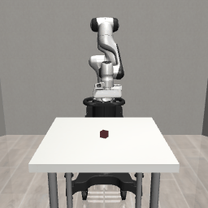
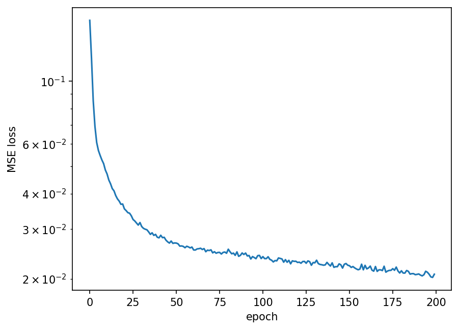
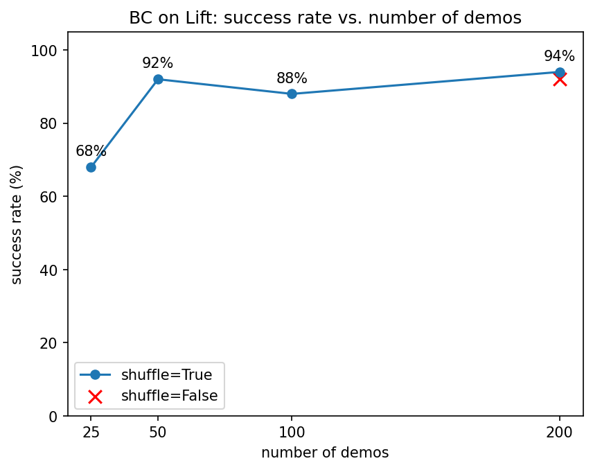

# lift-bc

로봇팔이 테이블 위 큐브를 들어 올리는 작업(robosuite **Lift**)을 사람 데모로 학습하는 **Behavior Cloning(BC)** 을 PyTorch로 직접 구현하고, **데모 수와 shuffle의 유무에 따라 성공률이 어떻게 달라지는지** 실험한 프로젝트입니다.



*데모 200개로 학습한 정책이 처음 보는 큐브 위치에서 큐브를 들어 올리는 장면*

## 무엇을 했나

- **가져온 것**: 시뮬레이션 환경(robosuite), 사람 데모 데이터셋(robomimic Lift, proficient-human, low-dim)
- **직접 구현한 것**: 데모 데이터 로딩, PyTorch Dataset, MLP 정책, 학습 루프, 시뮬레이션 롤아웃 평가(성공률 측정), 데모 수 실험

robomimic에 BC 구현이 포함되어 있지만 사용하지 않았고, 데이터셋 파일과 환경 생성 함수만 가져다 썼습니다.

## 문제 설정

| 항목 | 내용 |
| --- | --- |
| 작업 | Franka Panda 로봇팔로 테이블 위 큐브를 잡아 들어 올리기. 큐브가 테이블 위 일정 높이 이상 올라가면 성공 |
| 데이터 | 숙련된 사람 한 명이 원격 조종한 성공 데모 200개 (총 9,666 스텝, 20Hz) |
| 입력 (상태, 19차원) | 큐브 정보(`object`, 10) + 그리퍼 위치(`robot0_eef_pos`, 3) + 그리퍼 방향(`robot0_eef_quat`, 4) + 그리퍼 손가락 위치(`robot0_gripper_qpos`, 2) |
| 출력 (행동, 7차원) | 그리퍼 위치 이동(3) + 회전(3) + 그리퍼 열기/닫기(1), 각 값은 -1~1 |

데모를 0.05초 단위 스텝으로 잘라 (상태, 행동) 쌍 하나를 학습 데이터 하나로 사용합니다. 행동이 연속적인 실수이므로 분류가 아닌 회귀 문제로 보고 MSE 손실을 썼습니다.

## 방법

| 항목 | 설정 |
| --- | --- |
| 정책 | MLP: 19 → 256 → ReLU → 256 → ReLU → 7 |
| 손실 | MSE |
| 옵티마이저 | Adam, 학습률 1e-3 |
| 배치 크기 | 256 (매 에포크 섞음) |
| 학습량 | 가중치 갱신 7,600회 (데모 200개 기준 200 에포크), 선택한 데모들의 전체 스텝을 256(batch_size)개씩 나눠 에포크당 배치 수를 구한 뒤, 총 갱신 횟수가 7,600회가 되도록 에포크 수를 정함 (데모 200개는 200 에포크, 25개는 1,267 에포크) |
| 평가 | 학습한 정책으로 시뮬레이션에서 50회 시도, 큐브를 들어 올린 비율. 시도마다 큐브 위치가 무작위로 바뀌며, 모든 정책을 같은 50개 위치(seed 0)에서 평가. 시도당 최대 400스텝(20초) |

**공정한 비교를 위해** 데모 수가 달라도 가중치 갱신 횟수를 7,600회로 같게 맞췄습니다. 에포크 수를 고정하면 데모가 적을수록 학습량 자체가 줄어들어, 성공률 차이가 데이터 양 때문인지 학습량 때문인지 구분할 수 없기 때문입니다.

## 결과

### 베이스라인: 데모 200개

처음 보는 큐브 위치 50곳에서 **47번 성공 (94%)**. 성공한 시도는 대부분 38~54스텝 만에 끝나, 사람 데모 평균(약 48스텝)과 비슷한 속도로 동작했습니다.



### 데모 수별 성공률

| 데모 수 | 학습 스텝 수 | 에포크 | 최종 학습 손실 | 성공률 (50회) |
| --- | --- | --- | --- | --- |
| 25 | 1,293 | 1,267 | 0.0098 | **68%** (34/50) |
| 50 | 2,476 | 760 | 0.0115 | **92%** (46/50) |
| 100 | 4,699 | 400 | 0.0194 | **88%** (44/50) |
| 200 | 9,666 | 200 | 0.0208 | **94%** (47/50) |
| 200 (섞지 않음) | 9,666 | 200 | 0.0228 | **92%** (46/50) |



**해석**

- **데모 25개 → 50개에서 성공률이 크게 올랐습니다 (68% → 92%).** 50개 이상에서는 88~94%로 비슷했습니다. 50회 평가에서 성공률 90% 근처의 표준오차가 약 4%p라, 50·100·200개 사이의 차이는 이 실험만으로는 의미 있는 차이라고 보기 어렵습니다. Lift처럼 단순한 작업에서는 데모 약 50개면 충분한 성능에 가까워지는 것으로 보입니다.
- **학습 손실과 성공률은 반대로 움직였습니다.** 데모 25개일 때 학습 손실이 가장 낮았지만(0.0098) 성공률도 가장 낮았습니다. 적은 데이터를 여러 번 반복해 보면서 데모를 잘 외웠지만, 처음 보는 큐브 위치로는 일반화하지 못한 것으로 해석됩니다. 이는 같은 데이터를 1,267 에포크 반복해 학습하면서 과적합되었을 가능성이 높습니다. 따라서 학습 손실만으로는 정책의 성능을 판단할 수 없고, 처음 보는 상황에서도 잘 동작하는지 시뮬레이션 롤아웃으로 확인해야 합니다.
- **데모 25개 정책은 성공하더라도 머뭇거리는 경우가 있었습니다.** 다른 설정에서는 성공한 시도가 대부분 35에서 60스텝에 끝났지만, 25개일 때는 150에서 230스텝이 걸린 성공도 여러 번 있었습니다. 이는 데모 25개로 학습한 정책은 처음 보는 큐브 위치에서 덜 안정적으로 행동한다는 것을 보여줍니다. 다양한 큐브 위치를 담은 데모가 어느 정도(이 실험에서는 약 50개) 있어야 안정적으로 일반화되는 것으로 보입니다.
- **배치를 섞지 않아도 이 설정에서는 성공률 차이가 거의 없었습니다 (94% vs 92%).** 학습 손실은 섞지 않은 쪽이 약간 높았습니다(섞음 0.0208 vs 섞지 않음 0.0228). 매 에포크 전체 데이터를 다 보고 200 에포크를 반복하기 때문에 순서의 영향이 크지 않았던 것으로 보입니다.
- **25 → 50개에서 크게 오르고 그 뒤로는 비슷합니다** 데모 25 -> 50개의 경우 성공률이 크게 올랐습니다.(68% -> 92%) 50개 이상에서는 88% ~ 94%로 성공률이 비슷했습니다. 데모 100개의 성공률(88%)은 데모 50개의 성공률(92%)보다 낮게 나왔지만, 50번의 시도 중 2번 차이라 평가할 때 큐브 위치에 따른 운의 영향으로 볼 수 있습니다. 이를 통해서 평가 횟수를 늘리거나 시드를 여러 개로 반복하면, 이런 운의 영향을 줄일 수 있음을 알 수 있습니다. 또한, lift처럼 단순한 작업에서는 데모 약 50개면 충분한 성능에 가까워지는 것을 확인했습니다.

## 한계

- 시드 하나로 학습·평가한 결과라, 데모가 적을 때는 운에 따라 성공률이 달라질 수 있습니다.
- 상태를 숫자로 직접 받는 설정이며, 카메라 이미지 입력은 다루지 않았습니다.
- 현재 상태만 보고 행동하는 MLP라, 과거 스텝 정보가 필요한 상황은 고려하지 않습니다.


## 파일 구성

| 파일 | 내용 |
| --- | --- |
| `data_utils.py` | hdf5 데모 파일에서 상태 (N, 19), 행동 (N, 7) 배열 만들기 |
| `model.py` | `DemoDataset`, `BCPolicy` |
| `train.py` | 데모 200개로 학습하고 모델 저장 |
| `evaluate.py` | 저장된 정책을 시뮬레이션에서 50회 실행해 성공률 측정, 롤아웃 GIF 저장 |
| `run_experiment.py` | 데모 수·셔플 여부를 바꿔가며 학습·평가 반복, 결과 그래프 저장 |
| `scripts/` | 데이터 구조 확인, 환경 동작 확인용 스크립트 |

## 실행 방법

### 설치

```bash
conda create -n bc python=3.10
conda activate bc
pip install torch torchvision

mkdir -p ~/bc_ws && cd ~/bc_ws
git clone https://github.com/ARISE-Initiative/robosuite.git
cd robosuite && git checkout v1.5.1 && pip install -e . && cd ..
git clone https://github.com/ARISE-Initiative/robomimic.git
cd robomimic && pip install -e . && cd ..

# 최신 MuJoCo는 robosuite v1.5.1과 호환되지 않아(환경 생성 시 AssertionError) 버전을 고정
pip install "mujoco==3.2.7"
```

### 데이터 다운로드

```bash
cd ~/bc_ws/robomimic/robomimic/scripts
python download_datasets.py --tasks lift --dataset_types ph --hdf5_types low_dim
```

`data_utils.py`의 `DATA_PATH`를 다운로드한 파일 경로로 바꿔주세요.

### 학습·평가·실험

```bash
python train.py            # 데모 200개로 학습 → checkpoints/bc_all.pt
python evaluate.py         # 성공률 측정 → results/rollout_all.gif
python run_experiment.py   # 데모 수별 실험 → results/success_vs_demos.png, results/results.json
```

## 사용 버전

Python 3.10, PyTorch 2.14, robosuite 1.5.1, robomimic 0.5.0, MuJoCo 3.2.7
